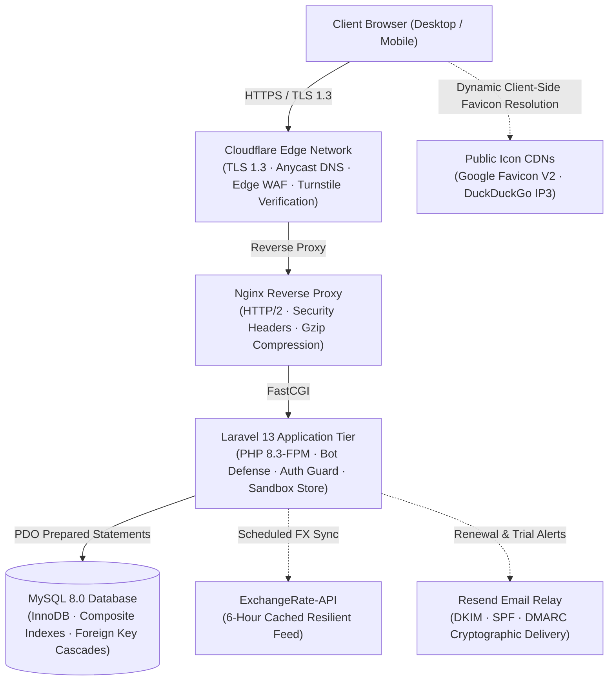

<p align="center">
  
</p>

<h1 align="center">SubShield</h1>

<p align="center">
  <strong>Privacy-First Digital Subscription Tracker with Real-Time Multi-Currency Normalisation</strong><br>
  An enterprise-grade, zero-bank-exposure personal subscription intelligence platform featuring automated foreign exchange conversion, proactive renewal notifications, intelligent trial management, and strict data sovereignty.
</p>

<p align="center">
  <a href="https://mysubshield.me"></a>
</p>

<p align="center">
  
  
  
  
  
  
  
  
  
</p>

---

## Architecture Overview



---

## Core Features

* **Zero Bank Credential Exposure:** Eliminates the privacy and security vulnerabilities of third-party screen-scraping aggregators (Plaid/Yodlee). Users maintain 100% control over their financial records.
* **Zero-File-Upload Security Model:** Enforces a strict zero-file-upload architecture. Eliminates multipart file parsers, user avatar uploads, and CSV file upload endpoints, completely closing off webshell, polyglot file, and storage symlink exploit vectors on host infrastructure.
* **Cloudflare Turnstile & Multi-Layer Bot Defense:** Protects authentication workflows (login, registration, password resets) using Cloudflare Turnstile token validation, honeypot traps, client device fingerprinting, and automatic scraper detection (jailing repetitive malicious bots while protecting legitimate users from lockout).
* **Dynamic Billing Cycle Rollover & 1-Click Renew:** Prevents subscriptions from remaining stuck in the past. One-click "Mark as Paid / Advance Cycle" updates and advances the next billing date by week, month, quarter, semi-annual, or annual periods.
* **Free Trial Tracking & Conversion Alerts:** Flags promotional trial subscriptions with proactive expiration countdowns, visual warning badges, and email notifications before automatic paid renewals take place.
* **Direct Provider Cancellation Links:** Stores direct URLs to service cancellation portals (`cancellation_url`), enabling 1-click access to unsubscribe when a user decides to stop.
* **Dynamic Client-Side Brand Discovery:** Users can type *any* brand or company name. The browser automatically infers the web domain (`brand.com`) and streams high-resolution icons on the fly via Google Favicon and DuckDuckGo CDNs—without storing bloated catalogs on the server VM. Includes quick 1-click TLD switchers (`.com`, `.io`, `.app`, `.ai`, `.co`).
* **Dynamic Multi-Currency Normalisation:** Converts foreign recurring billing (USD, EUR, GBP, SGD, JPY) into the user's preferred local currency (KES, MYR, USD, etc.) in real time with automated 6-hour rate caching.
* **Interactive Expenditure Analytics:** Monthly spending breakdown, category distributions, and yearly budget forecasts powered by Chart.js.
* **Data Sovereignty & Injection Neutralization:** One-click CSV export secured against **CWE-1236 (CSV / Formula Injection)**, alongside permanent self-serve account deletion complying with GDPR Article 17 ("Right to be Forgotten").
* **Guest Sandbox Mode:** Interactive demo sandbox with memory-backed state, allowing users to test the full subscription management suite safely without touching production persistence.

---

## Security Architecture & OWASP Alignment

| Security Pillar | Technical Implementation |
| :--- | :--- |
| **Access Control (A01)** | Anti-IDOR checks enforced across all controller endpoints (`abort_if($sub->user_id !== auth()->id(), 403)`). |
| **Cryptographic Hygiene (A02)** | Passwords hashed using Bcrypt (work factor 12). Session cookies enforce `Secure`, `HttpOnly`, and `SameSite=Lax`. |
| **Injection Defense (A03)** | 100% PDO prepared statements. CSV exports sanitize leading formula trigger characters (`=`, `+`, `-`, `@`, `\t`, `\r`) with single-quote escaping. |
| **Malware & Upload Prevention** | 100% zero user file uploads; all icons are dynamically resolved via public HTTPS CDNs (Google Favicon / DuckDuckGo). |
| **Security Misconfiguration (A05)** | Nginx server tokens suppressed; HTTP response headers enforce strict CSP with Web Worker permissions (`worker-src 'self' blob:;`), HSTS, `X-Frame-Options: SAMEORIGIN`, and `X-Content-Type-Options: nosniff`. |
| **Bot Mitigation & Anti-Brute-Force** | Cloudflare Turnstile cryptographic `siteverify` integration, automated scraper pattern detection (`python-requests`, `curl`, `httpx`), and IP violation jailing (`Cache::put('bot_defense:jailed:...')`). |

---

## Tech Stack

| Component | Technology | Role |
| :--- | :--- | :--- |
| **Backend** | Laravel 13 / PHP 8.3-FPM | Enterprise MVC application framework |
| **Database** | MySQL 8.0 (InnoDB) | Relational persistence with composite indexes & cascade constraints |
| **Frontend** | Blade, Bootstrap 5.3, Chart.js | WCAG AA compliant responsive UI |
| **Edge & Bot Mitigation** | Cloudflare / Turnstile | Edge routing, DDoS absorption, SSL termination, Bot CAPTCHA |
| **Web Server** | Nginx | Reverse proxy, static asset compression, FastCGI cache |
| **Mail Infrastructure** | Resend | Authenticated transactional delivery |

---

## Live Access

The production application is accessible at:

👉 **[https://mysubshield.me](https://mysubshield.me)**

Users can sign up for a free account, complete email verification via interactive 6-digit OTP, or explore the live guest sandbox mode instantly.

---

## Local Development Setup

### Prerequisites

* PHP 8.3 or higher
* Composer
* Node.js (v18+) & NPM
* MySQL 8.0 or MariaDB

### Quickstart

```bash
# 1. Clone the repository
git clone https://github.com/osman-builds/digital-subscription-tracker.git
cd digital-subscription-tracker

# 2. Install PHP and JavaScript dependencies
composer install
npm install

# 3. Environment configuration
cp .env.example .env
php artisan key:generate

# 4. Run database migrations and seeders
php artisan migrate --seed

# 5. Compile frontend assets
npm run build

# 6. Start the local server
php artisan serve
```

### Environment Variables (.env.example)

Configure your local or production environment using placeholder credentials:

```dotenv
APP_NAME=SubShield
APP_ENV=local
APP_KEY=
APP_DEBUG=true
APP_URL=http://127.0.0.1:8000

DB_CONNECTION=mysql
DB_HOST=127.0.0.1
DB_PORT=3306
DB_DATABASE=subscription_tracker
DB_USERNAME=root
DB_PASSWORD=

# Transactional Mail (Resend)
MAIL_MAILER=resend
RESEND_API_KEY=your_resend_api_key_here

# Foreign Exchange Currency Rates
EXCHANGE_RATE_API_KEY=your_exchangerate_api_key_here

# Cloudflare Turnstile Bot Defense (Optional - active when configured)
TURNSTILE_SITE_KEY=your_turnstile_site_key_here
TURNSTILE_SECRET_KEY=your_turnstile_secret_key_here
TURNSTILE_HOSTNAMES=mysubshield.me,localhost,127.0.0.1
```

---

## Automated Background Commands

```bash
# Evaluate upcoming renewals and dispatch alerts
php artisan subscriptions:remind --days=3

# Force-refresh foreign exchange market rates
php artisan fx:refresh --force

# Create timestamped JSON database snapshot
php artisan app:backup

# Run test suite
php artisan test --compact
```

---

## Quality & Testing Metrics

* **Automated Unit & Feature Tests:** 102 passed (491 assertions, 0 failures).
* **Code Style:** Formatted and validated against PSR-12 / Laravel standards via Laravel Pint.
* **Chrome DevTools Lighthouse Audit:**
  - Accessibility: **100 / 100**
  - Best Practices: **100 / 100**
  - SEO: **100 / 100**
  - Cumulative Layout Shift (CLS): **0.00**

---

## Author

* **Osman Abdullahi Ahmed**  
* Bachelor of Software Engineering (Honours), Universiti Tenaga Nasional (UNITEN)  
* Repository: [osman-builds/digital-subscription-tracker](https://github.com/osman-builds/digital-subscription-tracker)

---

## License

This project is licensed under the [MIT License](LICENSE).
