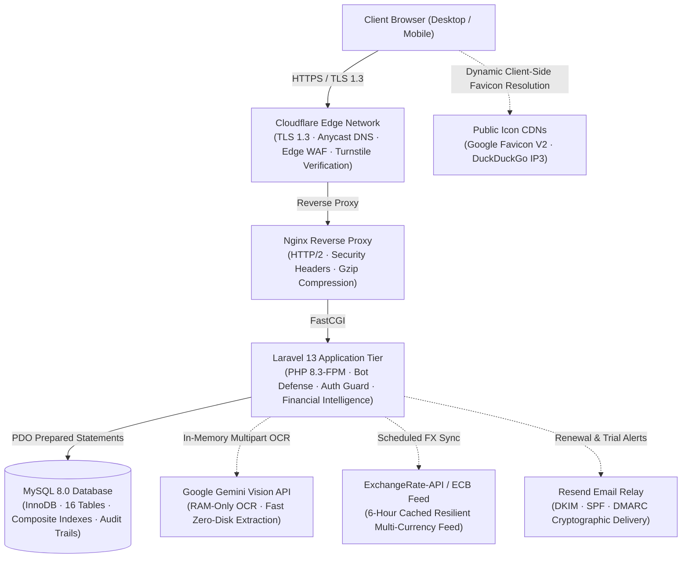

<p align="center">
  
</p>

<h1 align="center">SubShield</h1>

<p align="center">
  <strong>Privacy-First Digital Subscription Intelligence with Multimodal AI OCR &amp; Real-Time Multi-Currency Normalisation</strong><br>
  An enterprise-grade, zero-bank-exposure personal subscription intelligence platform featuring automated foreign exchange conversion, proactive renewal notifications, stealth price creep detection, 12-month renewal spike forecasting, intelligent trial management, and strict data sovereignty.
</p>

<p align="center">
  <a href="https://mysubshield.me"></a>
</p>

<p align="center">
  
  
  
  
  
  
  <a href="https://sonarcloud.io/summary/new_code?id=osman-builds_digital-subscription-tracker"></a>
  
  
  
  
</p>

---

## Architecture Overview



---

## Core Features & Intelligence Capabilities

* **Multimodal AI Receipt & Invoice Scanner:** Zero-disk Gemini multimodal OCR pipeline (`gemini-2.5-flash-lite` / `gemini-2.5-flash`). Files are ingested purely in RAM memory, verified with SHA-256 duplicate checks, and securely purged without writing temporary or persistent payloads to server storage.
* **0–100 Optimization Health Score:** Proprietary rating algorithm that dynamically benchmarks recurring portfolios, calculating transparent deductions for active budget cap overruns, impending trial-shock liabilities, and redundant software subscriptions.
* **Stealth Price Creep Tracking:** Automatically logs price amendments over time, computing month-over-month inflation percentage and annualized compounding cost impacts across historical renewals.
* **12-Month Renewal Spike Forecasting:** Proactively models the next 12 calendar months to flag cashflow spikes and redundant plan categories (e.g. concurrent streaming providers or overlapping generative AI tools).
* **Zero Bank Credential Exposure:** Eliminates the privacy and security vulnerabilities of third-party screen-scraping aggregators (Plaid/Yodlee). Users maintain 100% control over their financial records.
* **Cloudflare Turnstile & Multi-Layer Bot Defense:** Protects authentication workflows (login, registration, password resets, sandbox launch) using Cloudflare Turnstile cryptographic token validation, honeypot traps, client fingerprinting, and automated scraper detection.
* **Dynamic Multi-Currency Normalisation:** Real-time cross-currency normalization supporting 160+ world currencies against live European Central Bank (ECB) exchange rates with automatic fallback mechanisms.
* **Executive CSV & Printable A4 PDF Reports:**
  * Clean, formatted CSV spreadsheet exports with OWASP formula injection protection (`CWE-1236`).
  * High-density, professional A4 landscape PDF audit reports for both Subscription Portfolios (`/subscriptions/export/pdf`) and Annual Cashflow Breakdowns (`/expenditure/export/pdf`).
* **1-Hour Ephemeral Demo Sandbox:** Full-fidelity sandbox with 10 pre-populated global subscriptions (ChatGPT Plus, Netflix 4K, Figma Pro, GitHub Copilot, Adobe CC, etc.), pre-configured price creep history, trial countdowns, and ledger snapshots running strictly in memory with zero database writes.
* **Modernized Onboarding:** Interactive live preview window with dynamic multi-currency switcher on the public showcase, accompanied by a post-registration Quick-Start guide for new users.
* **Dynamic Billing Cycle Rollover & 1-Click Renew:** One-click "Mark as Paid / Advance Cycle" updates and advances the next billing date by week, month, quarter, semi-annual, or annual periods.
* **Direct Provider Cancellation Links:** Stores direct URLs to service cancellation portals (`cancellation_url`), enabling 1-click access to unsubscribe when a user decides to stop.
* **Data Sovereignty & GDPR Compliance:** Permanent self-serve account deletion complying with GDPR Article 17 ("Right to be Forgotten") with cascading deletion of all associated historical ledger entries, audit logs, and settings.

---

## Security Architecture & OWASP Alignment

| Security Pillar | Technical Implementation |
| :--- | :--- |
| **Access Control (A01)** | Anti-IDOR checks enforced across all controller endpoints (`abort_if($sub->user_id !== auth()->id(), 403)`). |
| **Cryptographic Hygiene (A02)** | Passwords hashed using Bcrypt (work factor 12). Session cookies enforce `Secure`, `HttpOnly`, and `SameSite=Lax`. |
| **Injection Defense (A03)** | 100% PDO prepared statements. CSV exports sanitize leading formula trigger characters (`=`, `+`, `-`, `@`, `\t`, `\r`) with single-quote escaping. |
| **Malware & Upload Prevention** | Zero persistent file uploads; AI receipt scans run entirely in RAM and purge immediately after extraction. Brand icons resolve via HTTPS CDNs. |
| **Security Misconfiguration (A05)** | Nginx server tokens suppressed; HTTP response headers enforce strict CSP with Web Worker permissions (`worker-src 'self' blob:;`), HSTS, `X-Frame-Options: SAMEORIGIN`, and `X-Content-Type-Options: nosniff`. |
| **Bot Mitigation & Anti-Brute-Force** | Cloudflare Turnstile cryptographic `siteverify` integration, automated scraper pattern detection (`python-requests`, `curl`, `httpx`), and IP violation jailing (`Cache::put('bot_defense:jailed:...')`). |

---

## Tech Stack

| Component | Technology | Role |
| :--- | :--- | :--- |
| **Backend** | Laravel 13 / PHP 8.3-FPM | Enterprise MVC application framework |
| **Database** | MySQL 8.0 (InnoDB) | 16 relational tables with composite indexes & cascade constraints |
| **AI Vision & OCR** | Google Gemini 2.5 API | Zero-disk multimodal document extraction in memory |
| **Frontend** | Blade, Bootstrap 5.3, Chart.js | WCAG AA compliant responsive UI with dark/light theming |
| **Edge & Bot Mitigation** | Cloudflare / Turnstile | Edge routing, DDoS absorption, SSL termination, Bot protection |
| **Web Server** | Nginx | Reverse proxy, static asset compression, FastCGI cache |
| **Mail Infrastructure** | Resend | Authenticated transactional delivery |

---

## Live Access

The production application is accessible at:

👉 **[https://mysubshield.me](https://mysubshield.me)**

Users can sign up for a free account, complete email verification via interactive 6-digit OTP, or explore the live guest sandbox mode instantly.

---

## Local Development Setup

### Prerequisites

* PHP 8.3 or higher
* Composer
* Node.js (v18+) & NPM
* MySQL 8.0 or MariaDB

### Quickstart

```bash
# 1. Clone the repository
git clone https://github.com/osman-builds/digital-subscription-tracker.git
cd digital-subscription-tracker

# 2. Install PHP and JavaScript dependencies
composer install
npm install

# 3. Environment configuration
cp .env.example .env
php artisan key:generate

# 4. Run database migrations and seeders
php artisan migrate --seed

# 5. Compile frontend assets
npm run build

# 6. Start the local server
php artisan serve
```

### Production Deployment Note

When deploying code updates to a remote production server, always ensure schema migrations are applied:

```bash
php artisan migrate --force
```

---

## Automated Background Commands

```bash
# Evaluate upcoming renewals and dispatch alerts
php artisan subscriptions:remind --days=3

# Force-refresh foreign exchange market rates
php artisan fx:refresh --force

# Create timestamped JSON database snapshot
php artisan app:backup

# Run test suite
php artisan test --compact
```

---

## Quality & Testing Metrics

* **Automated Unit & Feature Tests:** 131 passed (726 assertions, 0 failures).
* **Code Style:** Formatted and validated against PSR-12 / Laravel standards via Laravel Pint.
* **Chrome DevTools Lighthouse Audit:**
  - Accessibility: **100 / 100**
  - Best Practices: **100 / 100**
  - SEO: **100 / 100**
  - Cumulative Layout Shift (CLS): **0.00**

---

## Author

* **Osman Abdullahi Ahmed**  
* Bachelor of Software Engineering (Honours), Universiti Tenaga Nasional (UNITEN)  
* Repository: [osman-builds/digital-subscription-tracker](https://github.com/osman-builds/digital-subscription-tracker)

---

## License

This project is licensed under the [MIT License](LICENSE).
