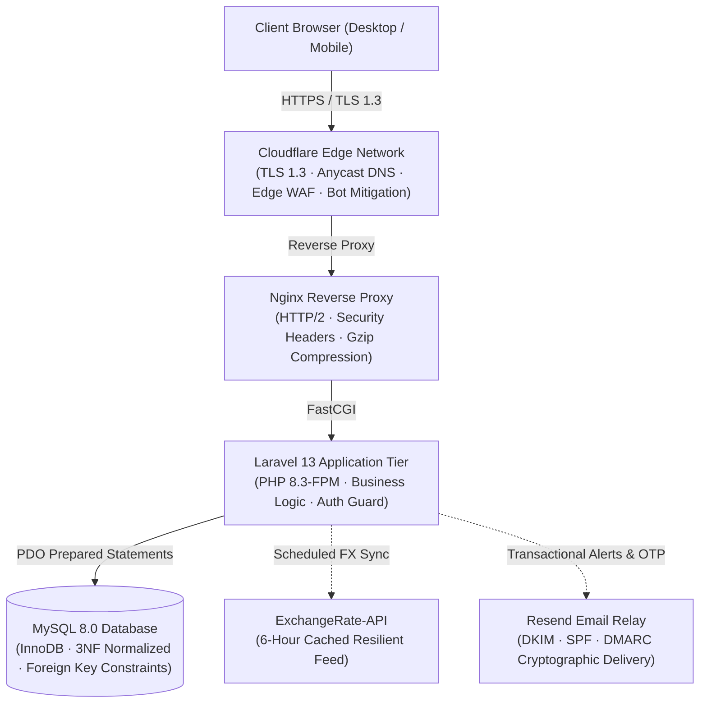

<p align="center">
  
</p>

<h1 align="center">SubShield</h1>

<p align="center">
  <strong>Privacy-First Digital Subscription Tracker with Real-Time Multi-Currency Normalisation</strong><br>
  An enterprise-grade, zero-bank-exposure personal subscription intelligence platform featuring automated foreign exchange conversion, proactive renewal notifications, and strict data sovereignty.
</p>

<p align="center">
  <a href="https://mysubshield.me"></a>
</p>

<p align="center">
  
  
  
  
  
  
  
  
</p>

---

## Architecture Overview



---

## Core Features

* **Zero Bank Credential Exposure:** Eliminates the privacy and security vulnerabilities of third-party screen-scraping aggregators (Plaid/Yodlee). Users maintain 100% control over their financial records.
* **Dynamic Multi-Currency Normalisation:** Converts foreign recurring billing (USD, EUR, GBP, SGD, JPY) into the user's preferred local currency (KES, MYR, USD, etc.) in real time with automated 6-hour rate caching.
* **Smart Brand Correction & Asset Sync:** Client-side typo detection automatically corrects misspelled subscription names (e.g., `netfix` $\to$ `Netflix`) and synchronizes official brand favicons.
* **Autonomous Renewal Reminders:** Daily background scheduler detects upcoming renewal deadlines and dispatches consolidated, localized email alerts based on custom lead-time preferences (3-day / 7-day).
* **Data Sovereignty & Injection Neutralization:** One-click CSV export secured against **CWE-1236 (CSV / Formula Injection)**, alongside permanent self-serve account deletion complying with GDPR Article 17 ("Right to be Forgotten").
* **Interactive Expenditure Analytics:** Monthly spending breakdown, category distributions, and yearly budget forecasts powered by Chart.js.

---

## Security Architecture & OWASP Alignment

| Security Pillar | Technical Implementation |
| :--- | :--- |
| **Access Control (A01)** | Anti-IDOR checks enforced across all controller endpoints (`abort_if($sub->user_id !== auth()->id(), 403)`). |
| **Cryptographic Hygiene (A02)** | Passwords hashed using Bcrypt with work factor 12. Session cookies enforce `Secure`, `HttpOnly`, and `SameSite=Lax`. |
| **Injection Defense (A03)** | 100% PDO prepared statements. CSV exports sanitize leading formula trigger characters (`=`, `+`, `-`, `@`, `\t`, `\r`) with single-quote escaping. |
| **Security Misconfiguration (A05)** | Nginx server tokens suppressed; HTTP response headers enforce strict CSP, HSTS, `X-Frame-Options: SAMEORIGIN`, and `X-Content-Type-Options: nosniff`. |
| **Rate Limiting & Anti-Brute-Force** | Auth endpoints protected with granular throttles (`throttle:5,10` on registration/password reset, `throttle:6,1` on OTP verification). |

---

## Tech Stack

| Component | Technology | Role |
| :--- | :--- | :--- |
| **Backend** | Laravel 13 / PHP 8.3-FPM | Enterprise MVC application framework |
| **Database** | MySQL 8.0 (InnoDB) | Relational persistence with cascade constraints |
| **Frontend** | Blade, Bootstrap 5.3, Chart.js | WCAG AA compliant responsive UI |
| **Edge & CDN** | Cloudflare | Anycast routing, DDoS absorption, SSL termination |
| **Web Server** | Nginx | Reverse proxy, static asset compression, FastCGI cache |
| **Mail Infrastructure** | Resend | Authenticated transactional delivery |

---

## Live Access

The production application is accessible at:

👉 **[https://mysubshield.me](https://mysubshield.me)**

Users can sign up for a free account, complete email verification via interactive 6-digit OTP, and immediately start organizing their digital subscriptions.

---

## Local Development Setup

### Prerequisites

* PHP 8.3 or higher
* Composer
* Node.js (v18+) & NPM
* MySQL 8.0 or MariaDB

### Quickstart

```bash
# 1. Clone the repository
git clone https://github.com/osman-builds/digital-subscription-tracker.git
cd digital-subscription-tracker

# 2. Install PHP and JavaScript dependencies
composer install
npm install

# 3. Environment configuration
cp .env.example .env
php artisan key:generate

# 4. Run database migrations and seeders
php artisan migrate --seed

# 5. Compile frontend assets
npm run build

# 6. Start the local server
php artisan serve
```

---

## Automated Background Commands

```bash
# Evaluate upcoming renewals and dispatch alerts
php artisan subscriptions:remind --days=3

# Force-refresh foreign exchange market rates
php artisan fx:refresh --force

# Create timestamped JSON database snapshot
php artisan app:backup

# Run test suite
php artisan test --compact
```

---

## Quality & Testing Metrics

* **Automated Unit & Feature Tests:** 57 passed (227 assertions, 0 failures).
* **Code Style:** Formatted and validated against PSR-12 via Laravel Pint.
* **Chrome DevTools Lighthouse Audit:**
  - Accessibility: **100 / 100**
  - Best Practices: **100 / 100**
  - SEO: **100 / 100**
  - Cumulative Layout Shift (CLS): **0.00**

---

## Author

* **Osman Abdullahi Ahmed**  
* Bachelor of Software Engineering (Honours), Universiti Tenaga Nasional (UNITEN)  
* Repository: [osman-builds/digital-subscription-tracker](https://github.com/osman-builds/digital-subscription-tracker)

---

## License

This project is licensed under the [MIT License](LICENSE).
